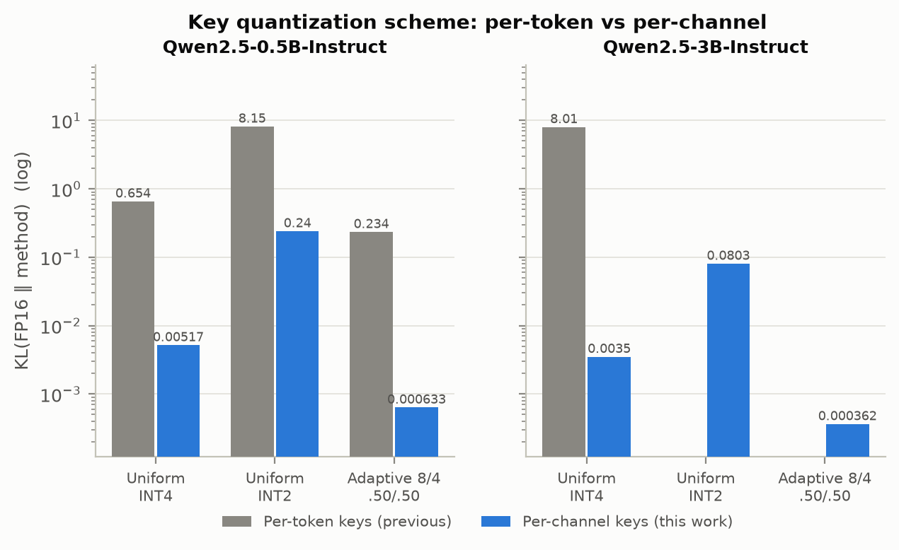
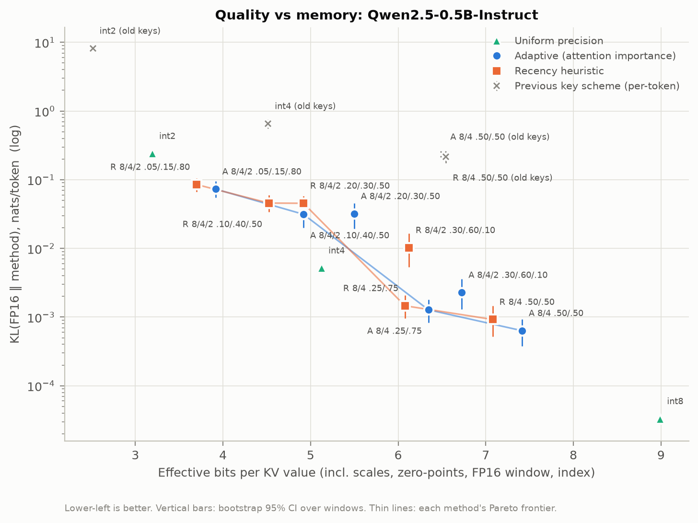
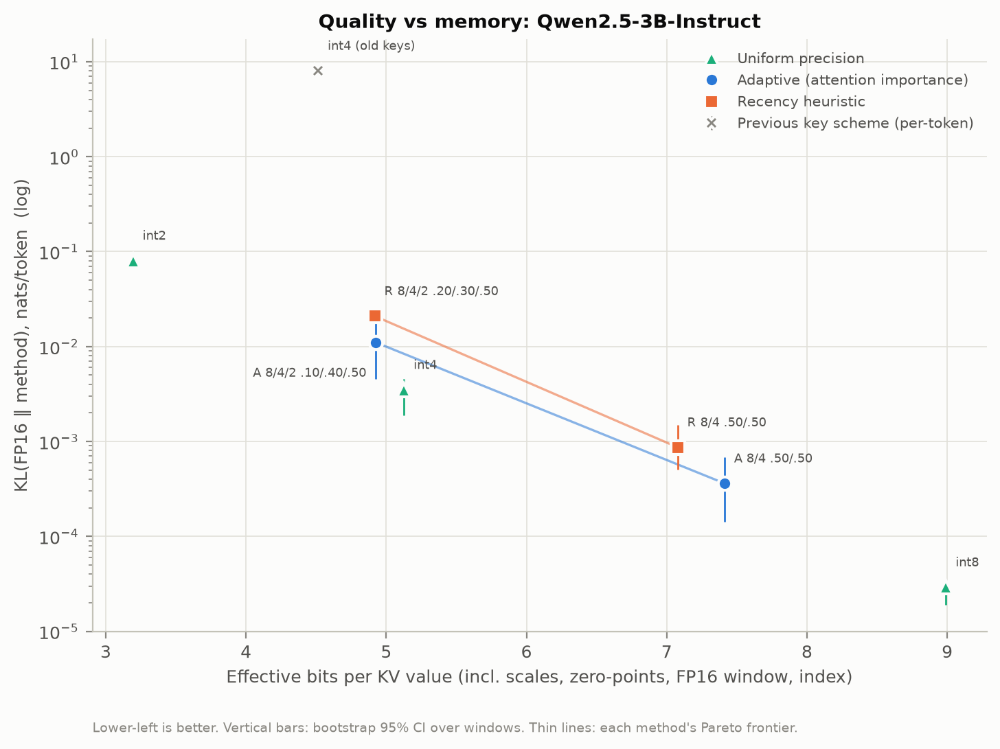
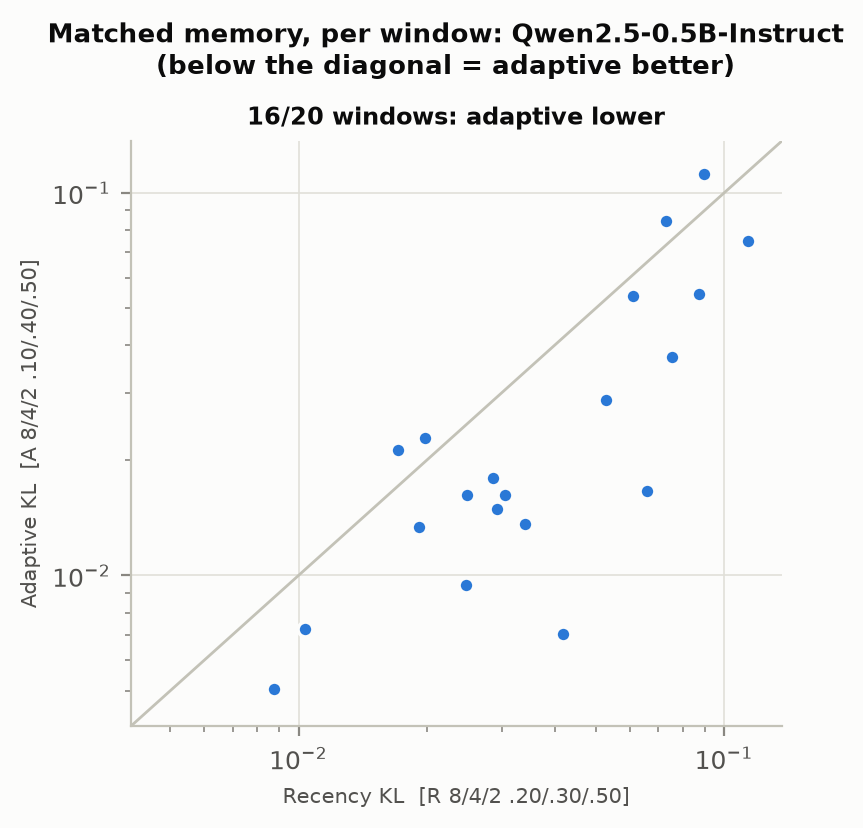
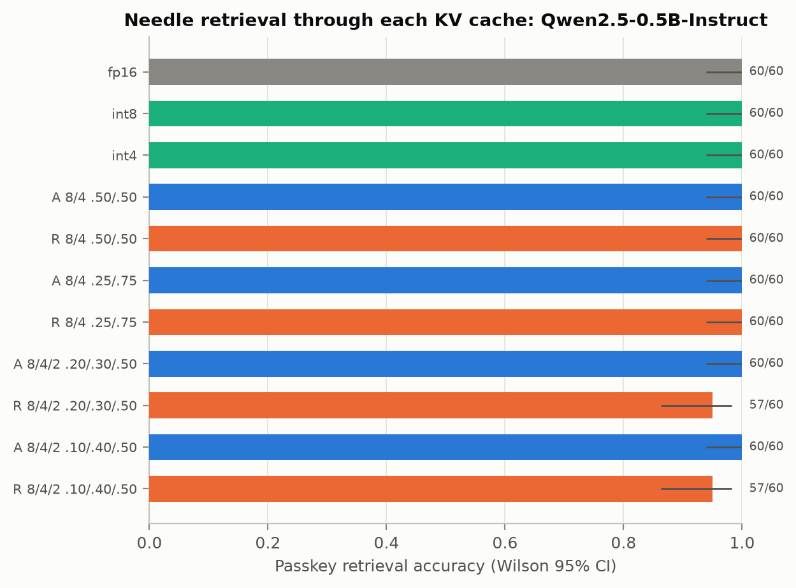
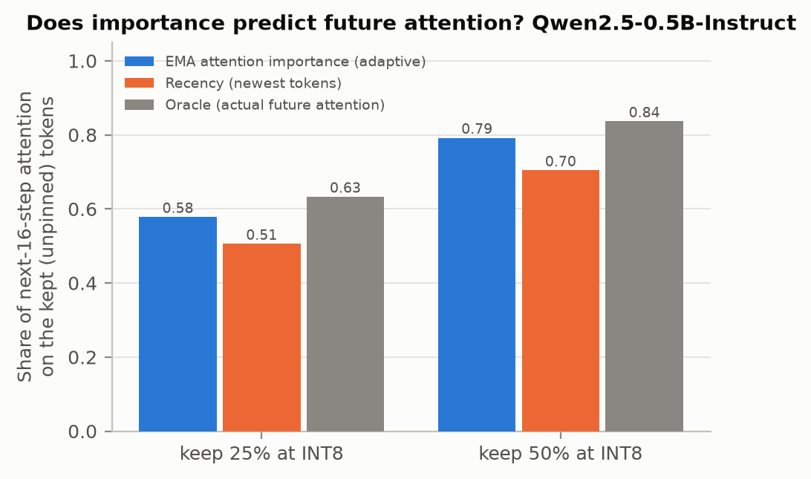
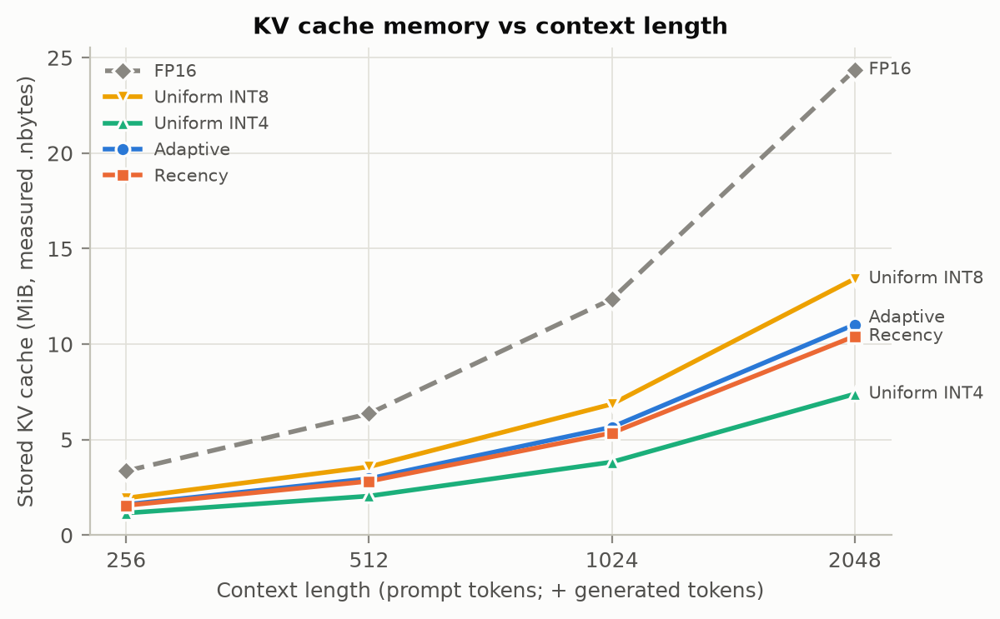

# AdaptiveKV: Attention-Guided Mixed-Precision KV-Cache Quantization on a 4 GB GPU

*Draft generated by `benchmarks/make_paper_report.py` on 2026-10-22T18:39 from `results/`. All numbers are measured on this machine (NVIDIA RTX 3050 Laptop, 4 GB); extrapolations are labelled. Regenerate, do not edit.*

## Abstract

The key-value (KV) cache of autoregressive LLMs grows linearly with context and dominates memory traffic during decoding. AdaptiveKV stores each cached token at INT8, INT4 or INT2, chosen by an exponential moving average (EMA) of the attention it receives, under fixed tier quotas, in pure PyTorch on a consumer GPU. We find that the quantization granularity of keys decides whether low precision works at all: quantizing keys per channel (KIVI-style) instead of per token lowers the KL divergence to FP16 of uniform INT4 from 0.654 to 0.00517 nats/token on Qwen2.5-0.5B-Instruct, and of uniform INT2 from 8.15 to 0.24. On Qwen2.5-3B-Instruct the per-token scheme makes uniform INT4 collapse (KL 8.01, perplexity +263,677%), while per-channel keys give KL 0.0035 (+1.1% perplexity). At matched memory (4.92 / 4.92 bits), attention-guided allocation (adaptive 8/4/2 0.10/0.40/0.50) had significantly lower KL to FP16 than the recency heuristic (recency 8/4/2 0.20/0.30/0.50; p=0.0027), significantly higher top-1 agreement (p=0.0062) and not significantly different perplexity (p=0.39). Uniform INT4 with per-channel keys stores 5.13 effective bits per value (3.12x smaller than FP16, all overheads included) at +0.6% perplexity. However, under our pre-registered Pareto rule no three-tier (INT2) mix beat uniform INT4 at equal or fewer bits: with per-channel keys, uniform INT4 is already near-lossless, so the measured benefit of attention guidance is in the mixed-precision regime, not in beating the best uniform format. Peak GPU memory is not reduced by this software prototype (the cache is dequantized for each attention call); the savings are in stored bytes.

## 1. Method

1. **Importance.** During each forward pass a hook on every attention module reduces the attention matrix to one score per cached token (mean over heads of the last 1 query row(s), uniform over layers) and discards the matrix. Scores are smoothed with an EMA (alpha = 0.1); a new token starts at its raw score.
2. **Tiers and quotas.** Fractions p8/p4/p2 of the cache are held at INT8/INT4/INT2. The first 4 tokens (attention sinks) are pinned at INT8. The newest 8 tokens stay FP16. When a token leaves that window it gets a tier; tiers are re-evaluated every step and may only be **demoted**, capped by the quotas, least-important first.
3. **Storage.** Values are quantized per token (asymmetric, groups of 64). Keys are quantized **per channel**: the keys of the same tier inside a block of 32 positions share one scale and zero-point per (head, channel). A key waits at FP16 until its block is complete. INT4/INT2 codes are bit-packed (2/4 per byte).
4. **Accounting.** Memory is the sum of `.nbytes` of every stored tensor: codes, scales, zero-points, FP16 window, pending keys and the 1-byte tier index. Effective bits = bytes x 8 / number of FP16 values.
5. **Baselines.** FP16 (native cache), uniform INT8/INT4/INT2 (same quantizer), and a recency heuristic that gives the newest tokens the highest precision at the same fractions and the same sink pins.

## 2. Experimental setup

| Item | Value |
|---|---|
| Date | 2026-10-13T16:56:57 |
| Model | Qwen/Qwen2.5-0.5B-Instruct (FP16 weights, eager attention) |
| KV shape (from model.config) | 24 layers x 2 KV heads x 64 head_dim |
| Weights offloaded to CPU | False |
| GPU | NVIDIA GeForce RTX 3050 Laptop GPU |
| Software | Python 3.11.9, torch 2.11.0+cu128, transformers 5.18.0 |
| Text | data/wikitext2_test.txt, 20 non-overlapping windows |
| Per window | 512 tokens prefilled, 64 tokens teacher-forced and scored |
| Group size / sink / recent / EMA alpha | 64 / 4 / 8 / 0.1 |
| Key quantization (default) | per_channel, key_group_tokens 32; the newest 8 tokens stay FP16, and a key waits at FP16 until its block is complete (both counted in memory; FP16 share of the tier mix) |
| Config hash | d7e725f7 |
| CI | bootstrap 95% over windows, 2000 resamples, seed 42 |
| Hardware safety | max GPU temp 75 C, 0 thermal pauses (0 s total; pause at 80 C, resume at 70 C) |

**Metrics.** Perplexity under teacher forcing *through* each KV cache; KL(FP16 ‖ method) of the next-token distribution and top-1 agreement with FP16 given the identical prefix; effective bits and compression from real tensor sizes; passkey retrieval accuracy (Wilson 95% CI); paired adaptive-vs-recency tests over identical windows (bootstrap 95% CI and Wilcoxon signed-rank; McNemar for passkey).

## 3. Results

### 3.1 Key quantization granularity decides whether low precision works



*Figure 1. KL to FP16 with per-token vs per-channel key quantization.* (vector version: `results/figures/fig2_key_scheme_ablation.pdf`)

| Model | Variant | KL per-token keys | KL per-channel keys | Ratio |
|---|---|---|---|---|
| Qwen2.5-0.5B-Instruct | int4_uniform | 0.6545 | 0.005169 | 127x |
| Qwen2.5-0.5B-Instruct | int2_uniform | 8.154 | 0.2401 | 34x |
| Qwen2.5-0.5B-Instruct | adaptive 8/4 0.50/0.50 | 0.2336 | 0.0006334 | 369x |
| Qwen2.5-3B-Instruct | int4_uniform | 8.006 | 0.003497 | 2290x |

**Three tiers (INT2).** Pre-registered rule result: no three-tier variant is on both frontiers. Every INT2 configuration is beaten by a variant that uses no INT2 at equal or fewer bits. Use two-tier INT8/INT4; report INT2 as a negative ablation.

### 3.2a Quality-memory trade-off: Qwen2.5-0.5B-Instruct



*Figure 2. Effective bits vs KL to FP16 (Qwen2.5-0.5B-Instruct).* (vector version: `results/figures/fig1_pareto_kl_Qwen2.5-0.5B-Instruct.pdf`)

PPL and KL: lower is better. Top-1: higher is better. Bits = effective bits per value including scales, zero-points and index. Pareto column: whether the variant is on the bits-vs-quality frontier among USABLE variants (at least as accurate as uniform INT4 on PPL and KL); no other usable variant has both fewer bits and better quality. 'excluded' = less accurate than uniform INT4. 'All' column: the same frontier over every variant without the usability gate.

| Variant | Bits | Compr. | PPL [95% CI] | ΔPPL vs FP16 | KL [95% CI] | Top-1 [95% CI] | Tier mix 8/4/2/FP16 | ms/tok | Pareto gated (KL, PPL) | Pareto all (KL, PPL) |
|---|---|---|---|---|---|---|---|---|---|---|
| fp16 | 16.00 | 1.00x | 13.531 [10.689, 17.235] | +0.0% | 0.0000 [0.0000, 0.0000] | 1.000 [1.000, 1.000] | - | 12.5 | - | - |
| int8_uniform | 8.99 | 1.78x | 13.533 [10.718, 17.125] | +0.0% | 0.0000 [0.0000, 0.0000] | 0.998 [0.994, 1.000] | 0.99/0.00/0.00/0.01 | 37.0 | yes, no | yes, no |
| int4_uniform | 5.13 | 3.12x | 13.609 [10.629, 17.361] | +0.6% | 0.0052 [0.0045, 0.0059] | 0.963 [0.952, 0.973] | 0.00/0.99/0.00/0.01 | 42.6 | yes, yes | yes, yes |
| int2_uniform | 3.20 | 5.01x | 16.577 [12.883, 21.129] | +22.5% | 0.2401 [0.2009, 0.2807] | 0.758 [0.726, 0.791] | 0.00/0.00/0.99/0.01 | 49.4 | excluded | yes, yes |
| adaptive 8/4 0.50/0.50 | 7.41 | 2.16x | 13.542 [10.796, 17.254] | +0.1% | 0.0006 [0.0004, 0.0009] | 0.988 [0.978, 0.995] | 0.49/0.50/0.00/0.01 | 69.5 | yes, no | yes, no |
| recency 8/4 0.50/0.50 | 7.08 | 2.26x | 13.531 [10.751, 17.320] | -0.0% | 0.0009 [0.0005, 0.0015] | 0.988 [0.981, 0.993] | 0.49/0.49/0.00/0.01 | 68.6 | yes, no | yes, no |
| adaptive 8/4 0.25/0.75 | 6.35 | 2.52x | 13.561 [10.655, 17.268] | +0.2% | 0.0013 [0.0008, 0.0018] | 0.990 [0.984, 0.995] | 0.24/0.75/0.00/0.01 | 78.5 | yes, yes | yes, yes |
| recency 8/4 0.25/0.75 | 6.08 | 2.63x | 13.578 [10.736, 17.131] | +0.3% | 0.0015 [0.0010, 0.0021] | 0.982 [0.973, 0.990] | 0.24/0.74/0.00/0.01 | 74.7 | yes, yes | yes, yes |
| adaptive 8/4/2 0.20/0.30/0.50 | 5.50 | 2.91x | 13.917 [10.948, 17.880] | +2.9% | 0.0320 [0.0195, 0.0457] | 0.931 [0.908, 0.951] | 0.19/0.30/0.50/0.01 | 110.7 | excluded | no, no |
| recency 8/4/2 0.20/0.30/0.50 | 4.92 | 3.25x | 13.832 [10.806, 17.517] | +2.2% | 0.0454 [0.0335, 0.0580] | 0.902 [0.883, 0.920] | 0.19/0.30/0.49/0.01 | 108.1 | excluded | yes, no |
| adaptive 8/4/2 0.30/0.60/0.10 | 6.73 | 2.38x | 13.517 [10.640, 17.278] | -0.1% | 0.0023 [0.0013, 0.0036] | 0.988 [0.980, 0.995] | 0.29/0.60/0.10/0.01 | 95.4 | no, yes | no, yes |
| recency 8/4/2 0.30/0.60/0.10 | 6.12 | 2.61x | 13.625 [10.806, 17.272] | +0.7% | 0.0102 [0.0054, 0.0164] | 0.961 [0.945, 0.974] | 0.29/0.60/0.09/0.01 | 91.8 | excluded | no, no |
| adaptive 8/4/2 0.10/0.40/0.50 | 4.92 | 3.25x | 13.947 [10.960, 17.539] | +3.1% | 0.0314 [0.0199, 0.0441] | 0.931 [0.912, 0.948] | 0.09/0.40/0.50/0.01 | 112.8 | excluded | yes, no |
| recency 8/4/2 0.10/0.40/0.50 | 4.52 | 3.54x | 13.823 [11.103, 17.529] | +2.2% | 0.0457 [0.0339, 0.0596] | 0.902 [0.883, 0.920] | 0.09/0.40/0.49/0.01 | 109.1 | excluded | yes, yes |
| adaptive 8/4/2 0.05/0.15/0.80 | 3.92 | 4.09x | 14.356 [11.427, 18.289] | +6.1% | 0.0730 [0.0549, 0.0949] | 0.877 [0.851, 0.903] | 0.04/0.15/0.80/0.01 | 113.7 | excluded | yes, yes |
| recency 8/4/2 0.05/0.15/0.80 | 3.70 | 4.33x | 14.473 [11.416, 18.256] | +7.0% | 0.0851 [0.0671, 0.1045] | 0.876 [0.850, 0.899] | 0.04/0.15/0.79/0.01 | 114.2 | excluded | yes, yes |
| int4_uniform [per-token keys] | 4.52 | 3.54x | 25.511 [20.152, 31.803] | +88.5% | 0.6545 [0.5603, 0.7547] | 0.655 [0.623, 0.684] | 0.00/1.00/0.00/0.00 | 31.1 | excluded | no, no |
| int2_uniform [per-token keys] | 2.52 | 6.36x | 40640.358 [24566.115, 69559.847] | +300253.1% | 8.1540 [7.5708, 8.7646] | 0.037 [0.027, 0.048] | 0.00/0.00/1.00/0.00 | 36.3 | excluded | yes, yes |
| adaptive 8/4 0.50/0.50 [per-token keys] | 6.52 | 2.45x | 16.754 [13.282, 21.109] | +23.8% | 0.2336 [0.2002, 0.2674] | 0.797 [0.766, 0.824] | 0.50/0.50/0.00/0.00 | 43.8 | excluded | no, no |
| recency 8/4 0.50/0.50 [per-token keys] | 6.55 | 2.44x | 16.162 [12.983, 20.021] | +19.4% | 0.2164 [0.1738, 0.2631] | 0.789 [0.762, 0.815] | 0.51/0.49/0.00/0.00 | 41.4 | excluded | no, no |

### 3.2b Quality-memory trade-off: Qwen2.5-3B-Instruct



*Figure 2. Effective bits vs KL to FP16 (Qwen2.5-3B-Instruct).* (vector version: `results/figures/fig1_pareto_kl_Qwen2.5-3B-Instruct.pdf`)

PPL and KL: lower is better. Top-1: higher is better. Bits = effective bits per value including scales, zero-points and index. Pareto column: whether the variant is on the bits-vs-quality frontier among USABLE variants (at least as accurate as uniform INT4 on PPL and KL); no other usable variant has both fewer bits and better quality. 'excluded' = less accurate than uniform INT4. 'All' column: the same frontier over every variant without the usability gate.

| Variant | Bits | Compr. | PPL [95% CI] | ΔPPL vs FP16 | KL [95% CI] | Top-1 [95% CI] | Tier mix 8/4/2/FP16 | ms/tok | Pareto gated (KL, PPL) | Pareto all (KL, PPL) |
|---|---|---|---|---|---|---|---|---|---|---|
| fp16 | 16.00 | 1.00x | 10.127 [5.327, 14.124] | +0.0% | 0.0000 [0.0000, 0.0000] | 1.000 [1.000, 1.000] | - | 661.4 | - | - |
| int8_uniform | 8.99 | 1.78x | 10.133 [5.324, 14.134] | +0.1% | 0.0000 [0.0000, 0.0000] | 1.000 [1.000, 1.000] | 0.99/0.00/0.00/0.01 | 726.3 | yes, yes | yes, no |
| int4_uniform | 5.13 | 3.12x | 10.234 [5.342, 14.351] | +1.1% | 0.0035 [0.0019, 0.0046] | 0.984 [0.969, 1.000] | 0.00/0.99/0.00/0.01 | 700.1 | yes, yes | yes, no |
| int2_uniform | 3.19 | 5.01x | 10.474 [5.570, 14.530] | +3.4% | 0.0803 [0.0677, 0.0930] | 0.854 [0.844, 0.859] | 0.00/0.00/0.99/0.01 | 722.2 | excluded | yes, yes |
| adaptive 8/4 0.50/0.50 | 7.41 | 2.16x | 10.146 [5.324, 14.190] | +0.2% | 0.0004 [0.0001, 0.0007] | 1.000 [1.000, 1.000] | 0.49/0.50/0.00/0.01 | 740.1 | yes, yes | yes, no |
| recency 8/4 0.50/0.50 | 7.08 | 2.26x | 10.199 [5.340, 14.251] | +0.7% | 0.0009 [0.0005, 0.0015] | 0.990 [0.984, 1.000] | 0.49/0.49/0.00/0.01 | 722.3 | yes, yes | yes, no |
| recency 8/4/2 0.20/0.30/0.50 | 4.92 | 3.25x | 10.362 [5.512, 14.409] | +2.3% | 0.0209 [0.0183, 0.0247] | 0.938 [0.922, 0.953] | 0.19/0.30/0.49/0.01 | 834.0 | excluded | yes, yes |
| adaptive 8/4/2 0.10/0.40/0.50 | 4.93 | 3.25x | 10.082 [5.272, 14.334] | -0.4% | 0.0111 [0.0046, 0.0225] | 0.969 [0.938, 1.000] | 0.09/0.40/0.50/0.01 | 841.4 | excluded | yes, yes |
| int4_uniform [per-token keys] | 4.51 | 3.54x | 26712.959 [18641.440, 34636.127] | +263677.1% | 8.0061 [7.2219, 8.9521] | 0.031 [0.016, 0.047] | 0.00/1.00/0.00/0.00 | 738.2 | excluded | no, no |

### 3.3 Attention-guided vs recency at matched memory



*Figure 3. Per-window KL at matched memory.* (vector version: `results/figures/fig3_bitmatched_Qwen2.5-0.5B-Instruct.pdf`)

**Qwen2.5-0.5B-Instruct**

Each adaptive variant is paired with the recency variant whose effective bits are closest (|Δbits| ≤ 0.15), on identical windows. This is the equal-memory comparison. Difference = adaptive minus recency; negative ΔKL/ΔNLL favour adaptive. Significant = 95% CI excludes 0 AND Wilcoxon p < 0.05.

| Adaptive | Recency | Bits (a / r) | ΔNLL per token [CI], p | ΔKL [CI], p | Δtop-1 [CI], p | Verdict |
|---|---|---|---|---|---|---|
| adaptive 8/4/2 0.10/0.40/0.50 | recency 8/4/2 0.20/0.30/0.50 | 4.92 / 4.92 | +0.0083 [-0.0154, +0.0309], p=0.388 | -0.0140 [-0.0219, -0.0061], p=0.00271 | +0.029 [+0.013, +0.045], p=0.00616 | adaptive better (by KL) |

**Qwen2.5-3B-Instruct**

Each adaptive variant is paired with the recency variant whose effective bits are closest (|Δbits| ≤ 0.15), on identical windows. This is the equal-memory comparison. Difference = adaptive minus recency; negative ΔKL/ΔNLL favour adaptive. Significant = 95% CI excludes 0 AND Wilcoxon p < 0.05.

| Adaptive | Recency | Bits (a / r) | ΔNLL per token [CI], p | ΔKL [CI], p | Δtop-1 [CI], p | Verdict |
|---|---|---|---|---|---|---|
| adaptive 8/4/2 0.10/0.40/0.50 | recency 8/4/2 0.20/0.30/0.50 | 4.93 / 4.92 | -0.0274 [-0.0445, -0.0052], p=0.25 | -0.0099 [-0.0152, -0.0022], p=0.25 | +0.031 [+0.000, +0.078], p=0.5 | no significant difference (by KL) |

### 3.4 Long-context retrieval (passkey)



*Figure 4. Passkey retrieval accuracy.* (vector version: `results/figures/fig5_passkey_Qwen2.5-0.5B-Instruct.pdf`)

**Overall accuracy**

| Method | Bits | Correct / n | Accuracy [Wilson 95% CI] |
|---|---|---|---|
| fp16 | 16.00 | 60 / 60 | 1.000 [0.940, 1.000] |
| int8_uniform | 8.93 | 60 / 60 | 1.000 [0.940, 1.000] |
| int4_uniform | 5.04 | 60 / 60 | 1.000 [0.940, 1.000] |
| adaptive 8/4 0.50/0.50 | 7.39 | 60 / 60 | 1.000 [0.940, 1.000] |
| recency 8/4 0.50/0.50 | 6.99 | 60 / 60 | 1.000 [0.940, 1.000] |
| adaptive 8/4 0.25/0.75 | 6.36 | 60 / 60 | 1.000 [0.940, 1.000] |
| recency 8/4 0.25/0.75 | 5.99 | 60 / 60 | 1.000 [0.940, 1.000] |
| adaptive 8/4/2 0.20/0.30/0.50 | 5.57 | 60 / 60 | 1.000 [0.940, 1.000] |
| recency 8/4/2 0.20/0.30/0.50 | 4.82 | 57 / 60 | 0.950 [0.863, 0.983] |
| adaptive 8/4/2 0.10/0.40/0.50 | 5.03 | 60 / 60 | 1.000 [0.940, 1.000] |
| recency 8/4/2 0.10/0.40/0.50 | 4.42 | 57 / 60 | 0.950 [0.863, 0.983] |

**Adaptive vs recency**

Exact McNemar test: binomial test on prompts where exactly one of the two is correct. Significant = p < 0.05.

| Tier mix | Both right | Only adaptive | Only recency | Both wrong | p | Verdict |
|---|---|---|---|---|---|---|
| 8/4 0.50/0.50 | 60 | 0 | 0 | 0 | 1 | no significant difference |
| 8/4 0.25/0.75 | 60 | 0 | 0 | 0 | 1 | no significant difference |
| 8/4/2 0.20/0.30/0.50 | 57 | 3 | 0 | 0 | 0.25 | no significant difference |
| 8/4/2 0.10/0.40/0.50 | 57 | 3 | 0 | 0 | 0.25 | no significant difference |

### 3.5 Why: does attention importance predict future attention?



*Figure 5. Share of future attention kept at INT8.* (vector version: `results/figures/fig6_importance_recall_Qwen2.5-0.5B-Instruct.pdf`)

Higher is better. 'vs oracle' = policy recall / oracle recall. Mean over windows (each window averaged over its decision times), bootstrap 95% CI over windows.

| p8 (kept share) | EMA (adaptive) | Recency | Oracle | EMA vs oracle | Recency vs oracle | EMA − recency, Wilcoxon p |
|---|---|---|---|---|---|---|
| 0.25 | 0.578 [0.554, 0.602] | 0.506 [0.473, 0.538] | 0.633 [0.616, 0.648] | 0.913 | 0.799 | +0.072, p=1.91e-06 |
| 0.50 | 0.792 [0.778, 0.807] | 0.704 [0.672, 0.734] | 0.836 [0.827, 0.845] | 0.947 | 0.842 | +0.088, p=1.91e-06 |

### 3.6 Stored memory and speed across context lengths



*Figure 6. Stored KV bytes vs context length.* (vector version: `results/figures/fig4_kv_memory_vs_context.pdf`)

| Method | Context | Stored KV (MiB) | Compression | Eff. bits | Prefill (s) | Decode (ms/token) | Peak VRAM (GB) |
|---|---|---|---|---|---|---|---|
| adaptive | 256 | 1.61 | 2.09x | 7.64 | 0.131 | 64.7 | 0.94 |
| adaptive | 512 | 2.96 | 2.15x | 7.45 | 0.271 | 79.8 | 0.97 |
| adaptive | 1024 | 5.66 | 2.18x | 7.32 | 0.530 | 80.8 | 1.06 |
| adaptive | 2048 | 11.03 | 2.21x | 7.24 | 1.085 | 69.8 | 1.42 |
| fp16 | 256 | 3.36 | 1.00x | 16.00 | 0.033 | 12.0 | 0.94 |
| fp16 | 512 | 6.36 | 1.00x | 16.00 | 0.059 | 12.0 | 0.97 |
| fp16 | 1024 | 12.36 | 1.00x | 16.00 | 0.148 | 14.2 | 1.06 |
| fp16 | 2048 | 24.36 | 1.00x | 16.00 | 0.477 | 14.4 | 1.42 |
| int4_uniform | 256 | 1.16 | 2.91x | 5.51 | 0.084 | 40.7 | 0.94 |
| int4_uniform | 512 | 2.05 | 3.11x | 5.15 | 0.174 | 49.0 | 0.97 |
| int4_uniform | 1024 | 3.83 | 3.23x | 4.96 | 0.369 | 53.4 | 1.06 |
| int4_uniform | 2048 | 7.39 | 3.30x | 4.86 | 0.835 | 46.7 | 1.42 |
| int8_uniform | 256 | 1.94 | 1.73x | 9.23 | 0.076 | 35.6 | 0.94 |
| int8_uniform | 512 | 3.58 | 1.78x | 9.01 | 0.157 | 43.7 | 0.97 |
| int8_uniform | 1024 | 6.86 | 1.80x | 8.88 | 0.320 | 43.3 | 1.06 |
| int8_uniform | 2048 | 13.43 | 1.81x | 8.82 | 0.808 | 46.0 | 1.42 |
| recency | 256 | 1.56 | 2.16x | 7.41 | 0.101 | 62.0 | 0.94 |
| recency | 512 | 2.82 | 2.25x | 7.10 | 0.193 | 75.9 | 0.97 |
| recency | 1024 | 5.35 | 2.31x | 6.93 | 0.369 | 77.1 | 1.06 |
| recency | 2048 | 10.42 | 2.34x | 6.84 | 0.819 | 68.2 | 1.42 |

Decode is slower than FP16: the prototype dequantizes the whole cache in Python/PyTorch every step; fused dequantize-attention kernels would be needed for a speed-up.

### 3.7 EXTRAPOLATED: larger contexts and models (not measured)

Measured stored/FP16 byte ratio x FP16 KV size from each model's config.json. Assumes the ratio carries over; unverified for adaptive/recency.

| Model | Method | Context | KV MiB (extrap.) | FP16 MiB |
|---|---|---|---|---|
| Qwen2.5-0.5B-Instruct | adaptive | 8192 | 44.5 | 96.0 |
| Qwen2.5-0.5B-Instruct | adaptive | 32768 | 177.9 | 384.0 |
| Qwen2.5-0.5B-Instruct | fp16 | 8192 | 96.0 | 96.0 |
| Qwen2.5-0.5B-Instruct | fp16 | 32768 | 384.0 | 384.0 |
| Qwen2.5-0.5B-Instruct | int4_uniform | 8192 | 30.7 | 96.0 |
| Qwen2.5-0.5B-Instruct | int4_uniform | 32768 | 122.8 | 384.0 |
| Qwen2.5-0.5B-Instruct | int8_uniform | 8192 | 53.9 | 96.0 |
| Qwen2.5-0.5B-Instruct | int8_uniform | 32768 | 215.6 | 384.0 |
| Qwen2.5-0.5B-Instruct | recency | 8192 | 42.4 | 96.0 |
| Qwen2.5-0.5B-Instruct | recency | 32768 | 169.7 | 384.0 |
| Qwen2.5-3B-Instruct | adaptive | 8192 | 133.5 | 288.0 |
| Qwen2.5-3B-Instruct | adaptive | 32768 | 533.8 | 1152.0 |
| Qwen2.5-3B-Instruct | fp16 | 8192 | 288.0 | 288.0 |
| Qwen2.5-3B-Instruct | fp16 | 32768 | 1152.0 | 1152.0 |
| Qwen2.5-3B-Instruct | int4_uniform | 8192 | 92.1 | 288.0 |
| Qwen2.5-3B-Instruct | int4_uniform | 32768 | 368.4 | 1152.0 |
| Qwen2.5-3B-Instruct | int8_uniform | 8192 | 161.7 | 288.0 |
| Qwen2.5-3B-Instruct | int8_uniform | 32768 | 646.9 | 1152.0 |
| Qwen2.5-3B-Instruct | recency | 8192 | 127.3 | 288.0 |
| Qwen2.5-3B-Instruct | recency | 32768 | 509.0 | 1152.0 |
| Qwen2.5-7B-Instruct | adaptive | 8192 | 207.6 | 448.0 |
| Qwen2.5-7B-Instruct | adaptive | 32768 | 830.4 | 1792.0 |
| Qwen2.5-7B-Instruct | fp16 | 8192 | 448.0 | 448.0 |
| Qwen2.5-7B-Instruct | fp16 | 32768 | 1792.0 | 1792.0 |
| Qwen2.5-7B-Instruct | int4_uniform | 8192 | 143.3 | 448.0 |
| Qwen2.5-7B-Instruct | int4_uniform | 32768 | 573.1 | 1792.0 |
| Qwen2.5-7B-Instruct | int8_uniform | 8192 | 251.6 | 448.0 |
| Qwen2.5-7B-Instruct | int8_uniform | 32768 | 1006.3 | 1792.0 |
| Qwen2.5-7B-Instruct | recency | 8192 | 197.9 | 448.0 |
| Qwen2.5-7B-Instruct | recency | 32768 | 791.8 | 1792.0 |

## 4. Limitations

- Peak VRAM is not reduced (dequantize-then-attend); only stored bytes shrink.
- Decode latency is higher than FP16 in this pure-PyTorch prototype.
- Quality is measured on WikiText-2 and a synthetic passkey task; no downstream benchmarks.
- With per-channel keys, scattering tiers across key blocks stores more scale sets, so adaptive uses more bits than recency at equal fractions; equal-memory comparisons (Section 3.3) account for this.
- Larger-model results use few windows (time budget) and CPU-offloaded weights; treat them as a confirmation, not a precise estimate.

## 5. Reproducibility

```
python -m pytest tests -q --junitxml=results/pytest_report.xml
python passkey.py
python importance_analysis.py
python decision_test.py
python benchmarks/run_baselines.py --config config_bench.yaml && python benchmarks/summarise.py
python benchmarks/extrapolate.py
python benchmarks/make_figures.py && python benchmarks/make_paper_report.py
```

### Test suite

Run at 2026-10-13T17:24:49.336360+05:30: **71 passed, 0 failed, 0 errors, 0 skipped** (71 test cases).


Full per-test listing: `results/VERIFICATION.md`.

